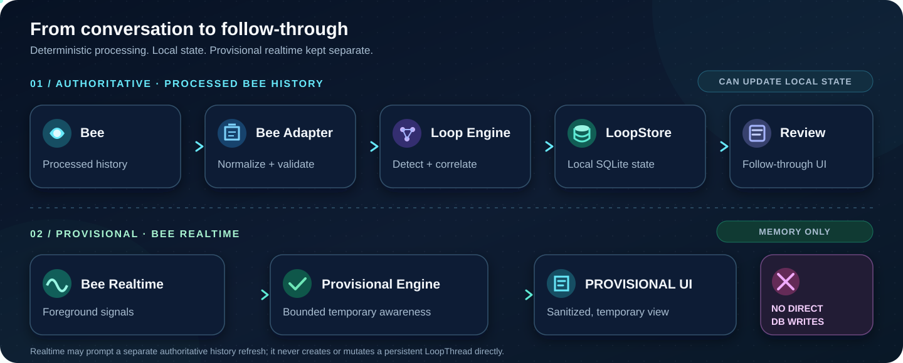
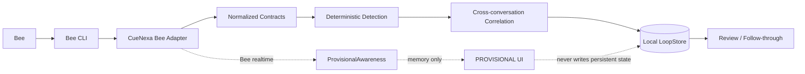

<div align="center">

# CueNexa Loop

### Bee remembers what happened. CueNexa Loop remembers what is still unfinished.

**Local-first follow-through intelligence for Amazon Bee**

[](https://github.com/mrdzyn/cuenexa-loop/actions/workflows/ci.yml)

[](LICENSE)


[Quickstart](#quickstart) ·
[How it works](#how-it-works) ·
[Electron reference](#working-electron-reference-app) ·
[Privacy](#privacy-by-design) ·
[Security](SECURITY.md) ·
[Documentation](#documentation)

</div>

> [!NOTE]
> **Contest status:** CueNexa Loop is in **HOLD-CONTEST-STABLE** while judging remains in progress through **November 21, 2026**. The submitted product is complete and intentionally stable; only genuine defect, security, dependency, or compatibility maintenance is in scope.

> [!IMPORTANT]
> **Processed Bee history is the only authority for persistent Loop state.** Realtime awareness is provisional, bounded, memory-only, and never writes persistent state directly.

<p align="center">
  
</p>

<p align="center"><sub>Animated architecture overview · authoritative persistence above · memory-only realtime below</sub></p>

## What CueNexa Loop does

CueNexa Loop is an open-source companion for Amazon Bee that turns conversational follow-through into a deterministic local workflow.

| Capability | What it does |
| --- | --- |
| **Detect** | Finds commitments, decisions, delegations, follow-ups, deadlines, and open questions from Bee-derived data. |
| **Correlate** | Groups strongly related items across conversations using deterministic high-confidence rules. |
| **Persist locally** | Maintains minimized structural `LoopThread` state in local SQLite without storing raw Bee transcripts or evidence. |
| **Prioritize** | Builds Due Now, Needs Attention, Waiting, Snoozed, and Recently Resolved review views. |
| **Act** | Supports local acknowledgement, snooze, pin, dismiss, restore, history, and notification deduplication. |
| **React in realtime** | Shows conservative `PROVISIONAL` signals from Bee realtime without making them persistence authority. |
| **Embed** | Ships a working Electron integration reference with sanitized IPC and a hardened renderer boundary. |

### At a glance

| | |
| --- | --- |
| **Architecture** | Local-first, deterministic, provider-independent above the Bee adapter |
| **Persistence** | Local SQLite, minimized derived structural state only |
| **Realtime** | Foreground, provisional, bounded, memory-only |
| **Cloud processing** | None added by CueNexa Loop |
| **External LLM** | None |
| **Telemetry / analytics** | None |
| **Tests** | Synthetic fixtures only |
| **Latest verified test baseline** | 56 test files / 465 tests passing, typecheck PASS, build PASS |
| **License** | MIT |

## How it works



The authoritative path and realtime path are deliberately separate:

| Authoritative history | Provisional realtime |
| --- | --- |
| Processed Bee history | Bee realtime stream |
| Deterministic detection/correlation | Conservative provisional signals |
| May reconcile `LoopStore` | **Zero direct `LoopStore` writes** |
| Drives durable review state | Drives temporary `PROVISIONAL` presentation |
| Repairs realtime gaps | Best-effort acceleration only |

## Working Electron reference app

A complete executable integration reference lives at:

### [`examples/electron-local-reference/`](examples/electron-local-reference/)

It demonstrates how a local Electron application can embed CueNexa Loop without weakening the project's privacy or authority boundaries.

```text
Bee processed history
        ↓
BeeAdapterClient
        ↓
detectLoopItems
        ↓
correlateLoopItems
        ↓
LoopStore.reconcile
        ↓
buildReviewModel
        ↓
sanitized IPC
        ↓
Electron Renderer
```

Optional realtime stays separate:

```text
Bee realtime
        ↓
BeeAdapterClient.subscribeRealtime()
        ↓
ProvisionalAwareness
        ↓
sanitized provisional DTO
        ↓
PROVISIONAL renderer section
        ↓
never persisted
```

### Electron security posture

The reference uses:

- `contextIsolation: true`
- `nodeIntegration: false`
- `sandbox: true`
- `webSecurity: true`
- no `webviewTag`
- no arbitrary navigation or window creation
- restrictive local CSP
- no CDN, telemetry, analytics, or remote fonts
- sanitized renderer DTOs only

The renderer never receives direct Bee, SQLite, filesystem, raw transcript, evidence, authentication, or realtime UUID access.

### Live acceptance

| Acceptance | Result | Evidence |
| --- | --- | --- |
| **P4-R1A — authoritative historical path** | **PASS** | [Live acceptance record](docs/audit/P4-R1A-LIVE-ACCEPTANCE-2026-10-06.md) |
| **P4-R1B — provisional realtime path** | **PASS** | [Live acceptance record](docs/audit/P4-R1B-LIVE-ACCEPTANCE-2026-10-07.md) |
| **P4-R1C — developer docs / polish** | **MERGED** | [P4-R1 contract](docs/P4-R1-ELECTRON-LOCAL-REFERENCE.md) |

The realtime acceptance directly verified that real Bee realtime produced sanitized provisional signals while causing **zero persistent thread/event changes** before authoritative processing.

## Privacy by design

CueNexa Loop works close to highly personal conversational data, so data minimization is an architectural rule rather than a UI preference.

| Boundary | CueNexa Loop behavior |
| --- | --- |
| Bee credentials | Remain managed by Bee tooling; CueNexa never implements or stores a Bee credential |
| Raw transcripts / utterances | Processed in memory when required; never persisted by CueNexa |
| Raw evidence / anchors | Never persisted |
| Precise location | Never persisted or printed |
| Realtime UUID mappings | Accepted only when Bee explicitly supplies both identifiers; memory-only |
| Default CLI output | Structural and content-free |
| `--include-content` | Explicit opt-in; redact before truncate |
| Local database | Derived structural follow-through state only |
| Cloud / external LLM | None |
| Test data | Synthetic fixtures only |

Read the full policies:

- [Privacy model](docs/PRIVACY.md)
- [Security architecture](docs/SECURITY.md)
- [Security reporting policy](SECURITY.md)

## Quickstart

### Prerequisites

- Node.js 22+
- npm
- Bee desktop app and Bee account
- Bee Developer Mode enabled
- official `@beeai/cli` on `PATH`
- authenticated Bee CLI session

### 1. Authenticate Bee

```bash
npm install -g @beeai/cli
bee login
bee status
```

CueNexa Loop does not run `bee login` for you and does not handle the underlying Bee credential.

### 2. Install and build

```bash
npm ci
npm run build
```

### 3. Sync and review follow-through

```bash
npm run loops:sync
npm run loops:review
```

### 4. Try the Electron reference

```bash
npm start --workspace @cuenexa-loop/electron-local-reference
```

For disposable Electron testing:

```bash
export CUENEXA_LOOP_ELECTRON_DB_PATH="/tmp/cuenexa-loop-electron-reference.sqlite"
npm start --workspace @cuenexa-loop/electron-local-reference
```

## Core commands

| Command | Purpose |
| --- | --- |
| `npm start` | Structural Bee connectivity check |
| `npm run loops:check` | Detect LoopItems from a fully hydrated Bee snapshot |
| `npm run loops:correlate` | Deterministically correlate high-confidence cross-conversation items |
| `npm run loops:sync` | Reconcile authoritative processed history into local structural state |
| `npm run loops:today` | Local deterministic attention view |
| `npm run loops:review` | Actionable structural review |
| `npm run loops:history` | Local structural event history |
| `npm run loops:notifications` | Preview local notification candidates |
| `npm run loops:notify` | Render + dedupe local notification delivery |
| `npm run loops:watch` | Foreground provisional realtime + authoritative refresh |
| `npm run loops:realtime-demo` | Synthetic deterministic realtime handoff demo |
| `npm run loops:reset -- --yes` | Explicitly erase CueNexa local state only |

Local user-state actions are also available through `loops:ack`, `loops:snooze`, `loops:unsnooze`, `loops:pin`, `loops:unpin`, `loops:dismiss`, and `loops:restore`.

### Content inspection is always explicit

Default output is structural and does not print private conversational content.

Use `--include-content` only when deliberately inspecting redacted/truncated content:

```bash
npm run loops:check -- --include-content
npm run loops:correlate -- --include-content
npm run loops:review -- --include-content
npm run loops:watch -- --include-content
```

Redaction runs **before** truncation, and precise coordinates are never printed.

## Local persistence

The CLI database defaults to:

```text
~/.cuenexa-loop/cuenexa-loop.sqlite
```

Use `CUENEXA_LOOP_DB_PATH` to override it.

The database stores minimized derived state such as thread IDs, hashed member identities, lifecycle, normalized due instants, structural events, bounded preferences, and notification delivery keys. It does **not** store Bee transcripts, summaries, raw LoopItem evidence, locations, people, credentials, or raw correlation anchors.

The Electron reference uses a separate app-specific database under Electron `userData` and supports `CUENEXA_LOOP_ELECTRON_DB_PATH` for disposable testing.

## Repository map

| Path | Responsibility |
| --- | --- |
| [`packages/contracts`](packages/contracts) | Provider-independent domain contracts and Zod schemas |
| [`packages/bee-adapter`](packages/bee-adapter) | The only Bee-specific integration boundary |
| [`packages/loop-engine`](packages/loop-engine) | Deterministic detection, correlation, and provisional awareness |
| [`packages/loop-store`](packages/loop-store) | Local SQLite persistence, reconciliation, attention, user state, notification ledger |
| [`packages/cli`](packages/cli) | Commands, presenters, orchestration, foreground watch runtime |
| [`examples/electron-local-reference`](examples/electron-local-reference) | Executable local Electron integration reference |

## Quality gates

```bash
npm run typecheck
npm test
npm run build
npm audit
```

CI uses synthetic fixtures only. Real Bee acceptance is manual and never runs against personal data in GitHub Actions.

## Known limitations

- Bee processed-history availability may lag realtime; manual **Process now** may sometimes be useful during live testing.
- Realtime is provisional, best-effort, and not persistence authority.
- Bee realtime UUIDs and historical numeric conversation IDs are different namespaces; CueNexa does not guess mappings.
- The Electron renderer starts without an in-memory review after restart until the next authoritative **Sync**.
- Spoken time-of-day fidelity has one documented non-blocking integration case and remains backlog only during contest hold.
- Workspace packages are private and are not published as a public npm SDK.

## Documentation

| Guide | Purpose |
| --- | --- |
| [Architecture](docs/ARCHITECTURE.md) | System boundaries and design |
| [Privacy](docs/PRIVACY.md) | Data handling and minimization |
| [Security architecture](docs/SECURITY.md) | Trust boundaries and threat model |
| [Security policy](SECURITY.md) | Vulnerability reporting |
| [Bee integration](docs/BEE_INTEGRATION.md) | Official Bee adapter behavior |
| [Loop detection](docs/LOOP-DETECTION.md) | Deterministic detection model |
| [Loop correlation](docs/LOOP-CORRELATION.md) | Scoring, complete-link grouping, lifecycle |
| [Persistence](docs/LOOP-PERSISTENCE.md) | Local structural state |
| [Proactive follow-through](docs/PROACTIVE-FOLLOW-THROUGH.md) | Phase 3 behavior |
| [Ambient realtime awareness](docs/AMBIENT-REALTIME-AWARENESS.md) | Phase 4 provisional/authoritative boundary |
| [Application Integration Guide](docs/APP-INTEGRATION-GUIDE.md) | Host integration and testing |
| [Electron reference README](examples/electron-local-reference/README.md) | Runnable desktop reference |
| [Developer friction log](docs/DEVPOST-FRICTION-LOG.md) | Bee developer feedback |

## Security reporting

Found a potential vulnerability? Please **do not disclose exploit details in a public issue or pull request**.

See [`SECURITY.md`](SECURITY.md) for private reporting guidance and privacy-safe reproduction requirements.

## License

CueNexa Loop is available under the [MIT License](LICENSE).

---

<div align="center">

**CueNexa Loop**

*Bee remembers what happened. CueNexa Loop remembers what is still unfinished.*

</div>
