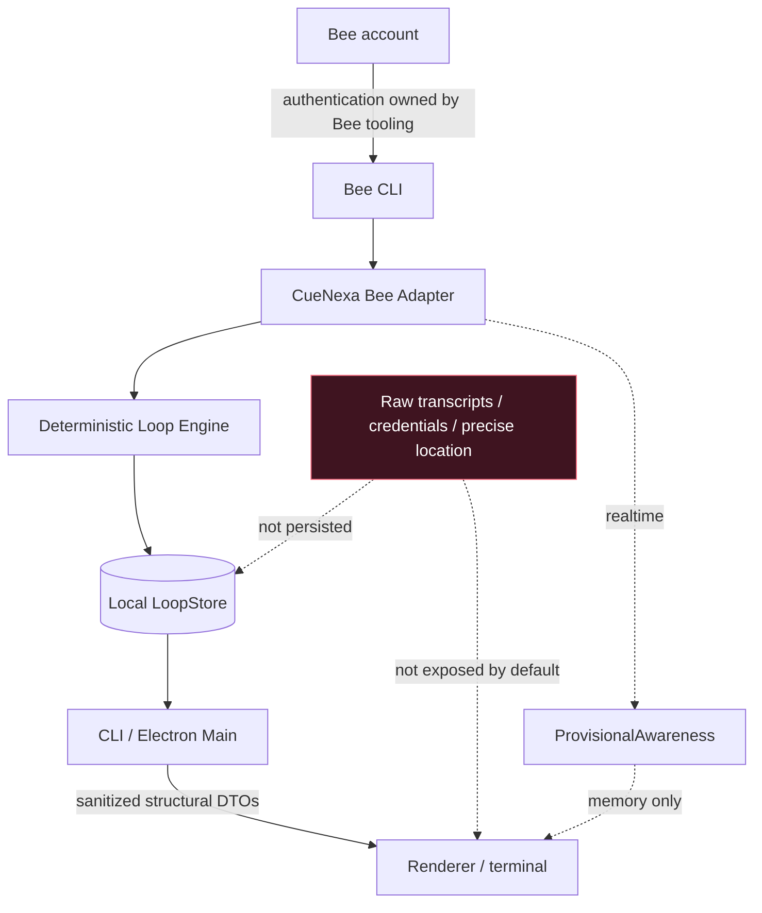

<div align="center">

# Security Policy

### Private reporting, local-first boundaries, and data-minimizing defaults


[Report privately](#reporting-a-vulnerability) ·
[Scope](#security-scope) ·
[Privacy-safe reporting](#privacy-safe-reporting) ·
[Architecture](#security-architecture)

</div>

> [!CAUTION]
> **Do not disclose vulnerability details in a public issue, discussion, or pull request.** Use GitHub private vulnerability reporting / Security Advisories when available.

> [!IMPORTANT]
> CueNexa Loop is designed to process highly personal conversational data with a minimized local trust boundary. Please use **synthetic or redacted evidence** whenever possible.

## Supported versions

CueNexa Loop is an early-stage open-source project. Security fixes are applied to the latest code on `main` unless a supported release line is documented later.

| Version | Supported |
| --- | ---: |
| Latest `main` | ✅ |
| Older commits / unreleased snapshots | ❌ |

## Security posture at a glance

| Boundary | Current posture |
| --- | --- |
| **Bee authentication** | Managed by Bee tooling; CueNexa does not implement or store Bee credentials |
| **Raw transcripts / utterances** | Never persisted by CueNexa Loop |
| **Realtime signals** | Provisional, bounded, memory-only |
| **Persistent state** | Minimized derived structural state in local SQLite |
| **Identity mapping** | Never guessed; accepted only when Bee explicitly supplies both identifiers |
| **Default output** | Structural and content-free |
| **Cloud processing** | None added by CueNexa Loop |
| **External LLM** | None |
| **Telemetry / analytics** | None |
| **Tests** | Synthetic fixtures only |
| **SQL handling** | Parameterized local SQLite operations |
| **Electron renderer** | Sanitized DTOs; no direct Bee, SQLite, filesystem, or raw-content access |

## Reporting a vulnerability

### Preferred: GitHub private vulnerability reporting

1. Open this repository's **Security** tab.
2. Choose **Report a vulnerability**.
3. Submit the minimum information needed to reproduce and assess the issue.

If private vulnerability reporting is unavailable, contact the repository owner privately using a contact method published on their GitHub profile.

Please avoid public disclosure while establishing private contact and during reasonable remediation.

### What to include

A useful report contains:

- a concise description of the issue;
- affected component(s), file(s), or commit(s);
- reproducible steps or a minimal proof of concept;
- expected versus observed behavior;
- likely security or privacy impact;
- prerequisites or environmental assumptions;
- suggested mitigation, if known.

## Privacy-safe reporting

Please **do not include real Bee personal data unless absolutely necessary**.

| Never include | Prefer instead |
| --- | --- |
| Bee credentials, session tokens, API keys | Placeholder / synthetic values |
| Raw conversation transcripts or utterances | Synthetic conversation fixtures |
| Private summaries, evidence, facts, or todos | Redacted minimal examples |
| Precise location | Fictional or coarse location |
| Real realtime UUIDs / session IDs | Synthetic identifiers |
| Personal screenshots | Sanitized reproduction screenshots |
| Raw logs containing private provider output | Minimal redacted excerpts |

If real Bee data is required to reproduce a problem, describe the minimum reproduction privately first rather than attaching raw personal content by default.

## Security scope

Reports are especially useful for issues involving:

- leakage or persistence of Bee-derived conversational content;
- exposure of credentials or authentication material;
- bypass of privacy-by-default output boundaries;
- realtime data mutating persistent `LoopThread` state directly;
- unsafe UUID / conversation identity mapping;
- unauthorized mutation, deletion, reopening, or resolution of persistent state;
- command injection or unsafe subprocess handling;
- path traversal or unsafe local file/database handling;
- SQL injection or persistence corruption;
- Electron IPC or renderer trust-boundary bypass;
- dependency or supply-chain vulnerabilities exploitable through CueNexa Loop;
- GitHub Actions or repository automation exposing secrets or allowing unauthorized changes.

### Upstream issues

Problems that are purely upstream in Bee, GitHub, Node.js, npm, Electron, or another dependency should normally be reported to that upstream project.

Please report them here when CueNexa Loop's implementation or configuration makes the upstream issue specifically exploitable through this repository.

## Security architecture



The full implementation-level threat model and trust-boundary details live in:

- [`docs/SECURITY.md`](docs/SECURITY.md)
- [`docs/PRIVACY.md`](docs/PRIVACY.md)
- [`docs/ARCHITECTURE.md`](docs/ARCHITECTURE.md)
- [`docs/BEE_INTEGRATION.md`](docs/BEE_INTEGRATION.md)

### Core invariants

1. **Processed Bee history is the only authority for persistent `LoopThread` state.**
2. **Realtime is provisional, bounded, best-effort, and memory-only.**
3. **Realtime never writes persistent state directly.**
4. **Raw Bee transcripts, summaries, utterances, evidence, precise location, credentials, raw anchors, and realtime UUIDs are not persisted.**
5. **Default output remains structural and content-free.**
6. **`--include-content` redacts before truncating.**
7. **Realtime UUID ↔ historical numeric-ID mappings are never guessed.**
8. **Partial/degraded source data remains visibly partial/degraded.**
9. **Tests use synthetic fixtures only.**
10. **No cloud service, telemetry, Bee writeback, background daemon, or external LLM is introduced by the current architecture.**

## Dependency and supply-chain posture

CueNexa Loop intentionally keeps the runtime surface small.

The repository uses the official Bee CLI integration boundary plus a minimal set of runtime dependencies, while local persistence uses Node's built-in SQLite support.

Repository quality gates include:

```bash
npm run typecheck
npm test
npm run build
npm audit
```

When `npm audit` reports an advisory, remediation should prefer the smallest compatible change that clears the issue rather than an unrelated or forced dependency rewrite.

## Public repository hygiene

This repository is public.

Before committing, contributors should explicitly check for:

- tokens, API keys, or authentication material;
- Bee exports;
- transcripts or personal facts/todos;
- real conversation/session identifiers;
- local SQLite/database files;
- `.env` files;
- private screenshots;
- machine-specific paths or logs containing personal data.

The repository's ignore rules help, but they are not a substitute for reviewing `git diff` and `git status` before committing.

## Disclosure and remediation

The maintainer will validate reports against the current repository state and coordinate remediation privately when appropriate.

Please allow reasonable time for investigation and remediation before public disclosure. Once a fix is available, disclosure timing should be coordinated so affected users have an opportunity to update.

---

<div align="center">

**Security questions are welcome. Vulnerability details should stay private until coordinated disclosure is appropriate.**

[Back to README](README.md)

</div>
